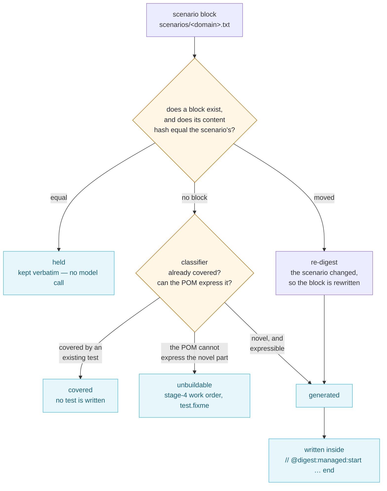
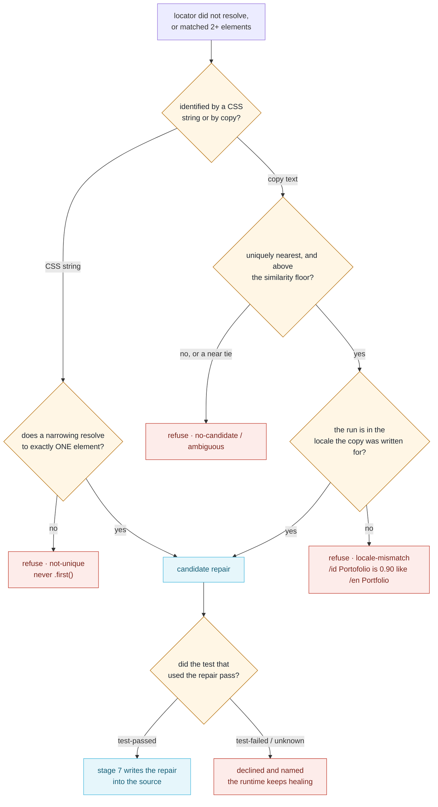
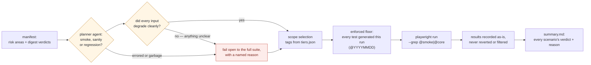
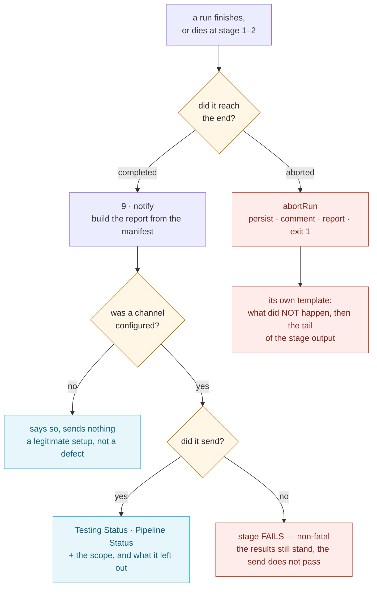

# The workflow, as diagrams

The pipeline has one end-to-end flow and four decisions that are worth
understanding on their own. The diagrams below are [Mermaid](https://mermaid.js.org)
source, so they render in GitHub, in VS Code, and in any Markdown viewer with
Mermaid support.

`deck/build-deck.py` renders the workshop deck, whose stage slide shows the same
flow; `deck/diagrams/d*.png` are these diagrams rendered to PNG for handouts and
printing, generated straight from this file (`d1`–`d5` below, in order):

```bash
node deck/render-mermaid.mjs      # needs: npx playwright install chromium
```

## Exporting to Excalidraw

`deck/diagrams/excalidraw/*.mmd` is each diagram on its own, ready to paste into
Excalidraw (*menu → Mermaid to Excalidraw*). Regenerate them from this file:

```bash
node deck/export-mermaid.mjs
```

Three things about that import — **checked against Excalidraw's own importer**
(`@excalidraw/mermaid-to-excalidraw`) rather than assumed:

| Mermaid | What Excalidraw does with it |
|---|---|
| `<br/>` | **not handled at all.** It lands in the label text as a literal `<br>`, and has to be cleaned up by hand. The export replaces it with a real newline, which the importer does keep — that is the one transformation the export makes. |
| `classDef` / `class` | honoured: `stroke` and `fill` become the element's stroke and background colour, so the diagram arrives already colour-coded. |
| `subgraph` | imports, but as a plain rectangle carrying the group's label — Excalidraw groups are not elements, so the phase label arrives as text you can move rather than a group you can drag. |

`subgraph` and `classDef` are kept in the export for exactly those reasons; only the
line breaks are rewritten. The check itself is `deck/excalidraw-import-check.html`
(serve the repo root and open it with `?src=<file>`) — it reports per diagram the
parse result, the element types, every label text, and any surviving `<br>`.

---

## 1. End to end: a deployment in, a reviewed PR out

```mermaid
flowchart LR
    IN(["a deployed change<br/>+ its PR diff"])

    subgraph P1["① decide what to cover"]
        S1["1 · gap-analysis"]
        S2["2 · testcase-digest"]
        S1 --> S2
    end

    subgraph P2["② build the vocabulary"]
        S3["3 · pom-builder"]
        S4["4 · digest-retry"]
        S3 --> S4
    end

    subgraph P3["③ run it"]
        S5["5 · test-plan"]
        S6["6 · playwright-test"]
        S5 --> S6
    end

    subgraph P4["④ repair, ship and report"]
        S7["7 · heal-apply"]
        S8["8 · git"]
        S9["9 · notify"]
        S7 --> S8
        S8 --> S9
    end

    IN --> S1
    S2 --> S3
    S4 --> S5
    S6 --> S7
    S8 --> OUT(["PR — a human reviews it,<br/>nothing merges itself"])
    S9 --> CHAT(["Telegram — result, scope,<br/>and what the scope left out"])

    S1 -. "fatal" .-> AB["abort — comments on the PR,<br/>reports to the chat, exits 1"]
    S2 -. "fatal" .-> AB

    classDef stage fill:#F3F5F8,stroke:#DDE2E8,color:#212630
    classDef io fill:#171B23,stroke:#171B23,color:#FFFFFF
    classDef bad fill:#FDECEA,stroke:#C0392B,color:#7B241C
    class S1,S2,S3,S4,S5,S6,S7,S8,S9 stage
    class IN,OUT,CHAT io
    class AB bad
```



**How to read it.** What passes between phases is *files on disk*, not conversation
history: a scenario file (`scenarios/<domain>.txt`), a page object
(`src/page-objects/<domain>/index.ts`), and the run manifest
(`artifacts/run/manifest.json`). That is what makes a single stage re-runnable in a
new process — `npm run stage:2` reads the manifest and refuses to guess if it is
missing.

**Fatal vs recorded.** Stages 1–2 are fatal, because they decide *what to cover* —
running the rest on a wrong plan wastes the run. Stages 3–7 record a failure and the
run continues, so one pass gives you the whole picture. Stage 8 is skipped when there
is nothing shippable. Stage 9 tells the chat, and is non-fatal too — but a report that
did not arrive *fails that stage*, so it can never pass for a quiet success.

**A run that dies still reports.** Because stage 9 is the *last* stage, an abort at
stage 1 or 2 would never reach it — the chat would stay silent on exactly the runs where
something went wrong. So the notification is not downstream of the failure: `abortRun`
persists the run record, comments on the source PR, sends its own message, and exits.
The abort message is a different template, not the normal report in another colour — see
§5.

---

## 2. Stage 2: the block hash decides first

This is the decision that makes the scenario file the source of truth. It is
read **before any model call**.



Why the hash comes first: a stale block carries the scenario's own *title*, so if the
coverage question were asked with that block in the evidence list, the block would
vouch for itself — the edit would never reach the spec, and the same scenario would be
re-decided on every later run, forever, under a green report.

---

## 3. Stage 7: heal, or refuse and say why

A refusal is not a bug. Healing exists to repair a stale *source line*; repairing "the
feature is gone" or "the test is wrong" turns a real regression into a green lie.



There is no model in this path, deliberately: a locator that is guessed wrong does not
fail — it asserts against the wrong element and passes, which is worse than the honest
failure it replaced.

---

## 4. The planner: what actually runs



The failure to watch for is not a red run — it is a *smaller green run*, where
everything that ran passed and the test that would have failed never ran at all. Hence
selection by **tag** rather than by title, hence the floor — and hence the agent's
answer being a name that code turns into a filter, rather than a filter itself.

### When a human decides instead

`TEST_GREP` — set in `.env` or exported for one run — makes the filter an operator's own
and **skips the agent entirely**. It is the one thing the floor steps aside for, because
someone who typed `@smoke` does not want surprise extras:

```bash
TEST_GREP=@smoke npm run pipeline -- --pr 123
```

Absolute in effect, never silent: the report says the run was *overridden* rather than
planned, names what the filter left out, and shouts when it excludes a test this run
wrote. `TEST_GREP` is never a standing value in the CI definition — that would pin every
run, silently — but it is a `workflow_dispatch` input, because a field a person fills in
per run is the same instruction as a command they typed:

```bash
gh workflow run test-pipeline -f pr=123 -f test_grep=@smoke
```

A manual run has no PR context, so stage 1 needs either `-f pr=<number>` or
`-f from_scenarios=true`; given neither, the run stops rather than proceeding against an
empty change set.

A CI run can also tell the two apart. An override that arrived from somewhere other than a
run-time input is named as a *leftover* rather than accepted as a decision — the same silent
smaller-green, one layer up.

---

## 5. The report channel: two statuses, and a run that died

Two things a report must never do: report a tick for a run that did not look, and go quiet
on the runs where something went wrong.



**Two statuses, never folded into one.** `Testing Status` is the product — what the browser
run found. `Pipeline Status` is the process — whether the run did its job. A failed test
leaves every stage `succeeded`, so one combined colour reads a red suite as a broken
pipeline and a broken pipeline as a red suite, and both send someone to fix the wrong one.

**The plan is stated as a decision.** `manifest.plan` carries the tier, the agent's own
reason and `source` (`planner` / `human` / `fail-open`), and the report renders it as a
sentence — *Smoke testing of PR #2 — chosen by the test-plan agent*, then the reason. A
fallback that widened the run says "widened by a fallback, not chosen" and quotes nothing,
because there is no agent sentence to quote and inventing one would put a decision in the
agent's mouth that it never made.

**The abort message is not the report in another colour.** A run that died has no scope, no
result and no coverage; printing those sections would print three lines of "nothing" under a
shape a reader has learned to scan. It carries the two labels, then what did *not* happen,
then the tail of the stage output — the tail, because a failing stage's own error is the
last thing it said.

---

## The files that carry state

| Artifact | What it is |
|---|---|
| `scenarios/<domain>.txt` | the source of truth; a block's hash is its scenario's text |
| `artifacts/run/manifest.json` | threads the stages together; `scenarios[]` is one row per scenario with its verdict and reason |
| `artifacts/run/summary.md` | "what just happened", also printed to the console |
| `artifacts/run/run-report.json` | the redacted audit trail: every stage's verbatim output |
| `artifacts/run/heals.json` | this run's repairs and refusals, each with the test that used it and whether that test passed |
| `tests/<domain>/*.spec.ts` | generated blocks inside managed regions, handwritten tests outside them |

## One stage at a time

```bash
npm run pipeline -- --pr 123     # all 9 stages
npm run stage:2                  # re-run ONE stage against the last manifest
npm run stage:3 -- --domain landing-page
npm run stage:6 -- --grep @core  # a tiered playwright run
npm run self-checks              # the invariants, in seconds, no browser
```

See `README.md` for the commands and `pipeline-pattern.md` for why each gate is where
it is.
